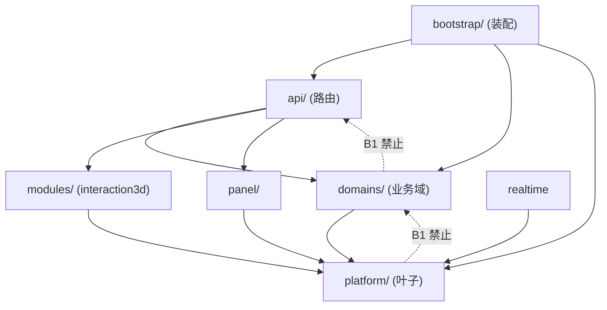

# 目录结构分析报告

> 位置说明：交付文档放在 `ops/analysis/` 而不是 `docs/`。仓库 `.gitignore` 明确写了
> 「`docs/` 里只允许放**可重跑的派生物**，不许放唯一输入」，整个目录不入库；
> 本文件是评审产物（不是派生物），所以落在入库的 `ops/analysis/`。
> 可重跑的检测产物仍然写在 `docs/analysis/code-duplication/`（见 `04-verification.md`）。

## 1. 分析范围与口径

| 项 | 取值 |
|---|---|
| 语言 / 扩展名 | TypeScript、JavaScript（`.ts` `.tsx` `.js` `.mjs`）、Vue SFC（`.vue`）、Python（`.py`） |
| 分析目录 | `homeos/frontend/{src,scripts}`、`homeos/backend/src`、`homeos-store/frontend/src`、`homeos-store/backend/src`、`packages/shared/src`、`packages/shared-py`、`ops` |
| 排除 | `node_modules/` `dist/` `build/` `target/` `out/` `vendor/` `.venv(-store)/` `__pycache__/` `public/` `assets/` `data/` `keys/` `docs/` `*.min.*` `*.d.ts` `*.generated.*` `*.pyi` `studio/shims/` |
| M1 精确克隆 | jscpd，`minLines=10` + `minTokens=50`，`mode=weak`（忽略注释），见 `.jscpd.json` |
| M2 近似重复 | 连续 10 个有效代码行、行集合 Jaccard ≥ 0.80，见 `ops/checks/dup_near.py` |

两条口径的分工写在 `3.x` 与 `04-verification.md`：M1 进 CI 做棘轮，M2 只出清单。

## 2. 盘点结果

### 2.1 各根目录体量

| 根目录 | 代码文件 | 说明 |
|---|---:|---|
| `homeos/frontend/src` | 1752 | 主应用（Vue 3 + 3D Studio） |
| `homeos/backend/src` | 503 | 主后端（FastAPI） |
| `homeos-store/backend/src` | 101 | 授权商店后端 |
| `homeos-store/frontend/src` | 96 | 授权商店前端 |
| `packages/shared/src` | 59 | 跨端共享（TS） |
| `packages/shared-py` | 17 | 跨端共享（Python 叶子模块） |
| `ops` | 207 | 门禁、构建、部署与架构测试 |
| **合计** | **2735** | jscpd 统计 669,911 行 / 3469 个「格式片段」 |

### 2.2 主应用前端分层

```
homeos/frontend/src
├── views/          路由页（15 个文件）—— 只做装配
├── features/       业务域（479）—— 每个 feature 自带 components/ composables/
├── components/     （197）跨 feature 的通用 UI（含 widgets/ shell/ modals/）
├── shared/         （243）纯函数、类型、常量、客户端工具（无业务状态）
├── composables/    （111）跨 feature 的组合式函数
├── stores/         （42）Pinia
├── services/       （18）axios / socket 客户端
├── studio/         （812）3D Studio 子应用（app / runtime / chrome / engine / entries / platform）
└── router, layouts, directives, workers, styles, types
```

`studio/` 是事实上的**子应用**（812 文件，占前端 46%），它有自己的 `app/`（编排）、`runtime/`（渲染与面板）、
`chrome/`（编辑器外壳）、`engine/`、`entries/`（独立入口）与 `platform/`。

### 2.3 后端分层

```
homeos/backend/src
├── api/          (51) 路由与 schema —— 只做 HTTP 边界
├── domains/     (303) 业务域（agent / ha / security / home_mode / notification / …）
├── modules/      (34) 与前端强耦合的模块面（interaction3d）
├── platform/     (78) 叶子基础设施（core/db, core/http, core/runtime, security）
├── realtime/     (14) WebSocket
├── bootstrap/    (11) 装配（lifespan / spa_static）
└── panel/         (4) 面板适配
```

依赖方向由 `ops/checks/architecture/check_backend_deps.py` 强制（B1–B7）：



商店后端是另一套独立根：`api/`（admin, payments, store）、`commerce/`、`licensing/`、`payments/{alipay,wechat,common}`、
`core/persistence/`、`security/`、`ops/`。

## 3. 已发现的边界问题与建议

按「收益 / 风险」排序。**本次只处理 P3 一条**（配置默认值单点化），其余列为后续独立阶段。

### P1 `domains/studio3d` ↔ `modules/interaction3d` 长期二元结构

- 现状：两个包互相依赖，已登记在 `check_backend_deps.py` 的 `HOMEOS_PACKAGE_WHITELIST`
  （`frozenset({"domains.studio3d", "modules.interaction3d"})`）。
- 后果：同一份「3D 舞台契约」被切成两半，谁该拥有它说不清；跨语言契约表（`EXTRA_TYPES`）就长在这条缝上。
- 建议：合并为单一 `domains/interaction3d`，把 `modules/` 只留给真正的「可插拔模块」。
  这是一次目录搬迁 + 依赖重排，**必须单独一个 PR**，并同步收紧白名单。
- 本次：只出映射表，不动目录。风险：搬 34 + N 个文件，路由基线 `routes-baseline.json` 可能跟着变。

### P2 `components/` 与 `shared/components/` 归属规则未成文

- 现状：`components/`（197 文件）与 `shared/components/`（在 `shared/` 243 文件内）都能放「通用组件」，
  实际两边都有：`components/common/*`、`components/widgets/*`、`shared/components/*`。
- 后果：新组件往哪放全凭直觉；同一个组件被两个 feature 用时容易各抄一份（本次修掉的
  `NotificationRowContent`、`PresenceStatusMeta` 就是这种土壤长出来的）。
- 建议：写死一条规则并机器校验——「被 ≥2 个 feature 引用 → `shared/components/`；
  仅单 feature 用 → 留在该 feature 的 `components/`」。用 `check_frontend_deps.mjs` 加一条断言。
- 本次：只在报告登记，不动文件。

### P3 配置读取面分散在三处（**本次已处理其第一步**）

- 现状：`domains/app_config/defaults.py` 是默认值权威源，但 `domains/security/config.py`
  与 `domains/notification/config.py` 各自**又抄了一份字面量**。
- 后果：改一处漏另一处 → 「导出给前端的默认值」与「后端 tick 用的默认值」变成两套数字。
- 本次：两处改为从 `DEFAULT_APP_CONFIG` 深拷贝派生（见 `03-refactor.md` R1）。
- 后续：`load_*_config()` 这层「默认值 + 已存覆盖」的样板在 3 个域里各写一遍，
  可收敛成 `app_config.section(session, name)` 一个函数。

### P4 跨语言契约表应当集中并由检查守护（**本次已加守护**）

- 现状：`EXTRA_TYPES`（Python）与 `extraTypes()`（TS）是同一张「域 → 控制类型」表，两份手写。
- 后果：两端不一致时「面板能显示、命令发不出去」，两侧单测都看不出来。
- 本次：新增 `ops/checks/check_extra_types_parity.py` 并接入 `gate:static`（R5），不做代码生成
  （生成器会成为第三处真相）。
- 后续：若再出现第二张跨语言表，可考虑统一放 `packages/shared/src/contracts/` 并由 parity 检查覆盖。

### P5 `studio/` 巨型编排宿主

`ops/checks/file-size-baseline.json` 里最大的 10 个文件全部在 `studio/`：

| 行数 | 文件 |
|---:|---|
| 4948 | `studio/runtime/core/stage.ts` |
| 4917 | `studio/app/editor/home/lifecycle/boot.ts` |
| 4182 | `studio/app/3d-studio/authoring/studio-app/boot.ts` |
| 3459 | `studio/runtime/config-ui/config-editor/rendering/panel-assembly.ts` |
| 3031 | `studio/app/3d-studio/authoring/studio-app/render/studio-render-loop.ts` |
| 2842 | `studio/runtime/core/runtime.ts` |
| 2772 | `studio/app/bridge/editor.ts` |
| 2698 | `studio/runtime/security/security-editor.ts` |
| 2562 | `studio/app/3d-studio/loaders/studio-external-models.ts` |
| 2170 | `studio/app/3d-studio/authoring/items/item-catalog.ts` |

`studio-app/boot.ts` 里有 **765 处 `*Impl` facade 包装**（`function x(...args: any[]): any { return xImpl(xDeps(), ...args) }`）。
这是**结构问题而非复制粘贴问题**：它是有意的「依赖倒置 + 显式依赖对象」手法，jscpd 把两侧
相同的 `xDeps()` 字面量报成克隆（本次剩余 6 个大克隆都来自它）。

- 建议：按 `check_split_budget.mjs` 的阶段预算继续拆（Phase 1 只管 `item-model`，可推进到
  `studio-app/home`），并让 facade 只保留**被外部调用**的那些。
- 本次：**刻意不动**。理由见 `03-refactor.md` 的「明确不做」。

## 4. 结构层面本次的净变化

| 变化 | 影响 |
|---|---|
| 新增 `ops/analysis/code-duplication/`（4 份评审文档） | 入库的评审产物 |
| 新增 `ops/checks/{check_duplicates.mjs, dup_near.py, check_extra_types_parity.py}` | 门禁与度量 |
| 新增 6 个 Vue 组件 / composable（`HomeModeContextPill`、`NotificationRowContent`、`PresenceStatusMeta`、`PresenceActions`、`useOrderDialog`、`ComponentActionTrigger`） | 均为「同一段被写了两遍以上」的片段，就地收口 |
| 无目录搬迁、无文件移动、无模块改名 | 路由基线、依赖基线、导入图均未变 |

净行数（如实记账，不美化）：

- 被改动的 31 个既有业务源码文件：**+649 / −725 = 净 −76 行**；
- 新增 6 个文件（5 个 Vue 组件 + 1 个 composable）：**+333 行**，注释占相当比例；
- 业务源码合计 **净 +257 行**，而**重复行 −328 行（−9.73%）**。

> 不要把「净 +257」读成「这次让代码变多了所以没价值」：新增的 333 行里，真正的新逻辑只有
> `useOrderDialog` 的 90 行与 `ComponentActionTrigger` 的 77 行；其余是 4 个纯展示组件的
> `defineProps` 与约束说明。删掉的 725 行则**全是**同一段逻辑的第二份、第三份拷贝。

也就是说：这次没有靠删代码取胜，而是把「同一件事写两遍」变成「写一遍 + 各自付一点调用成本」。
源码总量基本持平，换来的是 jscpd 绝对值下降 9.73%，以及「改一处必须记得改另一处」的清单缩短了 8 项。
具体数字见 `04-verification.md`。
